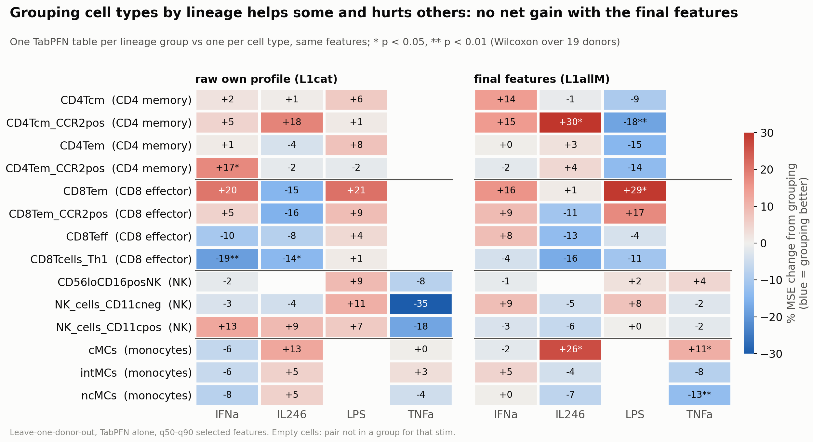

# 1. Held-out-donor work on the atlas perturbation maps

How well do stimulation maps predict a donor they have never seen, and how can we do better? Everything here is
evaluated on held-out donors: repeated designs (4 test donors, k = 1…15 training donors) and leave-one-donor-out
(19 folds). Checkpoints and hyper-parameters are chosen on training donors only.

> **Scale note.** The notebooks and older notes in this folder use the skill scale (1 − |error| / |effect|). The
> numbers in this README, the top-level README and `figures/` are MSE / RMSE.

## Final result
On leave-one-donor-out (19 donors, 5 stims, selected features q50–q90), the best predictor of an unseen donor's
stimulated quantiles is **0.4 × CellOT conditioned on phenotype subclusters + 0.6 × (average response + TabPFN
residual)**: MSE **0.0305** vs 0.0398 for the paper's CellOT (−23 %) and 0.0363 for paired CellOT + average response
(18/19 donors better). Notebooks with results: `notebooks/final_comparison.ipynb`, `notebooks/tab_models.ipynb`.

## Map of the folder

**Core work**

| part | code | notebook |
|---|---|---|
| held-out designs, learning curve, scoring | `lc/design.py`, `lc/cache.py`, `lc/score.py`, `lc/lodo_summary.py` | `learning_curve.ipynb` (with results) |
| closed-form baselines (identity, median shift, quantile map, Gaussian OT) | `lc/baselines.py` | `learning_curve.ipynb` |
| CellOT at scale: batched ICNNs on one GPU, exact equivalence test, parity with the paper's maps | `lc/batched_icnn.py`, `lc/train.py`, `lc/test_equivalence.py`, `lc/reference_icnn.py`, `slurm/` | |
| donor covariates: conditional CellOT, closed-form conditional maps, donor-ID oracle, paired sampling | `lc/cond_icnn.py`, `lc/cond_train.py`, `lc/cond_baselines.py`, `lc/residual_predict.py`, `lc/ctx_score.py`, `lc/var_score.py` | `model_zoo.ipynb` |
| ensembles with the average response, where CellOT is right or wrong | `lc/err_corr.py`, `lc/hybrid_rules.py`, `lc/where_skill.py` | `where_cellot_skill.ipynb` |
| TabPFN / LightGBM models of the donor-specific residual | `lc/tab_features.py`, `lc/tab_v2.py`, `lc/tab_ens.py`, `lc/tab_compare.py`, `lc/tab_v2_shap.py` | `tab_models.ipynb` (with results) |
| final comparison of ~60 methods, noise floor | `lc/final_compare.py`, `lc/noise_floor_lodo.py` | `final_comparison.ipynb` (with results) |

**Supporting analyses**

| part | code | notebook |
|---|---|---|
| plate / well noise (3 control plates per donor × stim) | `lc/plate_variance.py`, `lc/dmso_*.py`, `lc/plate_classify.py` | `dmso_plate.ipynb` |
| donor experiments: pregnant vs not, good / hard donors, cells vs donors | `lc/design_donors.py`, `lc/analyze_donors.py`, `lc/hvpv_features.py`, `lc/small_budget.py` | `learning_curve.ipynb` |
| drugs on held-out donors | `lc/drug_tables.py`, `lc/drug_tab.py`, `lc/drug_step.py`, `heldout/score_drugs.py` | `drug_heldout.ipynb` |
| quantile feature sets for the labour-onset model (Stabl, 100 splits) | `heldout/inclusion.py`, `heldout/quantile_arms.py`, `heldout/selq_corr.py` | |
| inputs of the pregnancy cohort vs the atlas range; phenotypic markers under stims; well consistency | `heldout/atlas_vs_ool.py`, `heldout/pheno_summary.py`, `heldout/well_consistency.py` | `atlas_vs_ool.ipynb`, `phenotype_shifts.ipynb`, `well_consistency.ipynb` |

**Negative results** (see below): `fm/` (foundation model), `lc/condot_train.py` (one network for all maps),
`lc/dnorm_*.py` (per-donor normalisation), `heldout/donor_covariate.py` (discriminant donor axes).

## Donor covariates (conditional CellOT)
A standard map gives the same prediction to identical cells whatever donor they come from. The conditional ICNN
(`lc/cond_icnn.py`, CondOT-style) takes a donor covariate as a second input: the covariate shifts each layer's biases
and gates its weights, the network stays convex in the cells for every covariate value (so it is still an optimal
transport map), and weight decay on the covariate path prevents memorising the training donors. The covariate is
computed from the new donor's own resting cells only.

Covariates tested: PCs of the donor's resting profile, the whole-blood profile (4 dominant cell types), learned donor
embeddings, discriminant donor axes, and the cell's phenotype subcluster (K = 4 per map, on stimulation-stable
phenotypic markers; training pairs resting and stimulated cells within the same donor and subcluster).

Leave-one-donor-out MSE: paired CellOT 0.0387; + whole-blood covariate 0.0361; + phenotype subclusters 0.0370
(17/19 donors better); averaged 50/50 with the average response 0.0346 / 0.0353. Without regularisation the covariate
memorises the training donors (+176 % MSE). With few training donors a covariate hurts: the subcluster covariate helps
from 5 donors, the whole-blood covariate only around 15 (`figures/04_learning_curve.png`).

## TabPFN feature sets
One TabPFN v2 table per (stim, cell type); target = the donor's deviation from the average response; one row per
(donor, quantile, marker). Exact column lists: `LAYERS_CT` / `LAYERS_GROUP` in `lc/tab_v2.py` (first round:
`lc/tab_features.py`). Results: `notebooks/tab_models.ipynb`, `notebooks/final_comparison.ipynb` §7-8.

Building blocks:

| block | content | columns |
|---|---|---|
| `BASE` | donor's resting deviation, training-donor resting / stim means, average effect, spread, noise, quantile, marker | 7 |
| `L1` | donor's raw resting profile in this cell type: 13 markers × 5 quantiles | 65 |
| `L1PC` | PCs of that profile | 5-7 |
| `F28` | log frequencies of the 28 cell types | 28 |
| `FPC` | PCs of the frequencies | 3 |
| `hvpv` | pregnant or not | 1 |
| `BPC` | PCs of the whole-blood resting profile | 3 |
| `MK` (mk28) | the same marker × quantile measured in the donor's other 27 cell types | 28 |
| `DW` | mean and SD of those 28 values | 2 |
| `OM` | own profile summarised per marker: mean + spread (q90 − q10) | 26 |
| `FLIN` | log frequencies of the 8 lineages | 8 |

Successive sets, TabPFN alone, leave-one-donor-out (19 donors, 5 stims, q50-q90 selected features), MSE:

| set | composition | MSE |
|---|---|---|
| `S0` | BASE only | 0.0415 |
| `S1_5` | + 5 PCs of the own profile | 0.0362 |
| `S2` / `S3` / `S4_3` | + frequency PCs / + pregnant / + whole-blood PCs | 0.0361 / 0.0361 / 0.0352 |
| `L1cat` | BASE + raw own profile (instead of PCs) | 0.0346 |
| `L1F` | + 28 raw frequencies | 0.0342 |
| `L1all_raw` | + frequencies, pregnant, whole-blood PCs | 0.0341 |
| `L1X` | L1cat + summary of the other cell types (DW) + the 4 dominant cell types | 0.0336 |
| `L1M` | L1cat + mk28 + DW | 0.0340 |
| **`L1allM`** | L1all_raw + mk28 + DW (134 columns) | **0.0327** |
| ablations of L1allM | without whole-blood PCs / without frequencies / without own profile / mk28 + DW only | 0.0325 / 0.0332 / 0.0343 / 0.0383 |
| reductions | own profile as 10 PCs / 5 PLS components | 0.0345 / 0.0350 |
| **`C_ms_lin`** | compact (72 columns): BASE + mk28 + DW + pregnant + `OM` + `FLIN` | **0.0322** |

### Grouping by lineage
Instead of one table per (stim, cell type), one TabPFN table per (stim, lineage group) with the cell type as a column,
so related cell types share training rows (`--mode group` in `lc/tab_v2.py`, layers `G_*`). Three groupings:
`cur` (curated per stim: CD4 memory, CD8 effector, CD16+ NK, monocytes), `big` (CD4 T, CD8 T, NK, myeloid) and `T`
(all T cells together). Each is compared with the per-cell-type tables on the same cell types and features.

Change in MSE, group table vs per-cell-type table, TabPFN alone, leave-one-donor-out (donors better out of 19):

| features | `cur` | `big` | `T` |
|---|---|---|---|
| L1cat (raw own profile) | +0.8 % (8) | 0.0 % (9) | −0.9 % (12) |
| L1all_raw (+ frequencies) | −2.4 % (12) | −2.4 % (12) | |
| L1M (+ other cell types) | −0.3 % (11) | −2.7 % (10) | −3.8 % (12) |
| **L1allM** (final features) | −1.2 % (10) | −2.1 % (11) | +3.4 % (10) |
| L1allM mixed with CellOT | +0.8 % | −0.1 % | +2.4 % |

Per lineage group (L1allM, TabPFN alone): CD4 memory −1.3 %, CD8 effector −2.8 %, CD16+ NK +2.6 %, CD11c NK (IL246)
−5.7 %, monocytes −0.5 %; big groups: CD4 T −1.0 %, CD8 T −4.4 %, NK −1.1 %, myeloid −1.9 %. None is significant
(Wilcoxon over donors, p ≥ 0.2).

Reading: with weaker features and fewer donors, grouping helped (k = 15: −5 to −7 % for L1cat / L1all_raw,
p 0.03-0.05), because related cell types lend each other training rows. Once the table already contains the same
marker measured in the donor's other cell types (mk28), grouping adds nothing: that feature carries the cross-cell-type
information more directly. Lineage grouping is therefore not part of the final model.

Per (cell type, stim): grouping helps some pairs (CD8 Th1 with IFNa / IL246, NK with TNFa when the features are weak)
and hurts others (some CD4 memory and CD8 effector pairs, classical monocytes with IL246), with no net gain once the
final features are used. Code: `lc/tab_v2.py --mode group --groupset cur|big|T` (groups in `GROUPSETS`), jobs
`slurm/lineage2*.sbatch`, summaries `lc/lineage2_summary.py`; an earlier round (PC features, 15 donors) is in
`notebooks/tab_models.ipynb` §8.
Reference points: average response alone 0.0419, paper CellOT 0.0398; mixed 0.4 / 0.6 with subcluster CellOT,
L1allM gives 0.0305 (the final model).

## Negative results
- **Cytometry foundation model (ImmuneFM, `fm/`).** Vendored from github.com/buttelab/ImmuneFM (Ding, Bhattacharya,
  Butte, bioRxiv 2025); its weights have no licence and are not included. Frozen, it misses 63 % of the stimulation
  responses and reconstructs masked markers worse than per-marker statistics. Fine-tuned on the atlas and used as a
  donor covariate, starting from its weights is no better than a random start (MSE 0.0213 vs 0.0215). The phenotype
  subcluster idea that is kept in the final model started here (`fm/stratified.py`).
- **One conditional network for all 168 maps (CondOT, `lc/condot_train.py`):** +113 % MSE vs per-pair CellOT.
- **Per-donor normalised inputs (`lc/dnorm_*.py`):** +16 % MSE.
- **Flow matching / Meta Flow Matching:** see `../explorations/meta_flow_matching/` (+52–55 % MSE).
- **Discriminant donor axes (`heldout/donor_covariate.py`):** they recognise a held-out donor from one resting well
  (`notebooks/fig_donor_covariate_ident.png`) but do not improve predictions as a covariate.

## Environment
- `env.sh`: GPU training (cluster PyTorch 2.4 / CUDA 12.6 module); `env_cpu.sh`: caches, baselines, scoring, notebooks.
- Closed-form baselines and the reference ICNN (`lc/reference_icnn.py`) are adapted from the SIMCO repository.
- Paths point to the lab's storage on Sherlock; the data are not included. Folder originally named `atlas_heldout`.

References: CellOT (Bunne et al., Nature Methods 2023); CondOT (Bunne, Krause, Cuturi, NeurIPS 2022); Meta Flow
Matching (Atanackovic et al., ICLR 2025); TabPFN v2 (Hollmann et al., Nature 2025).
