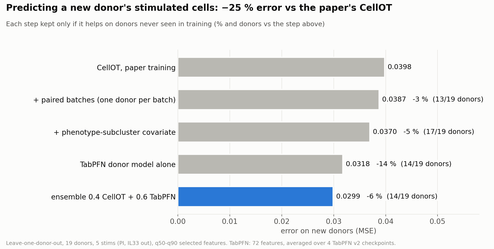
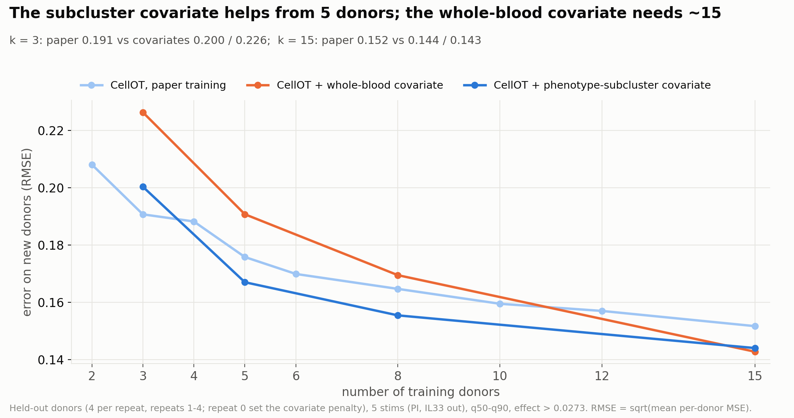
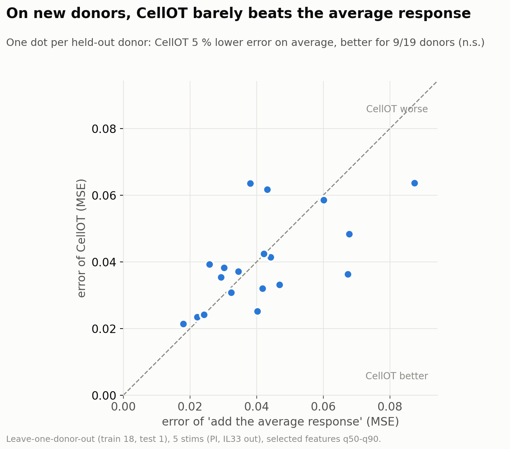
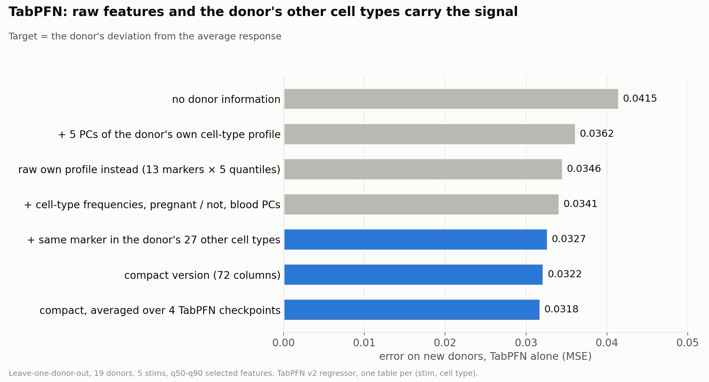
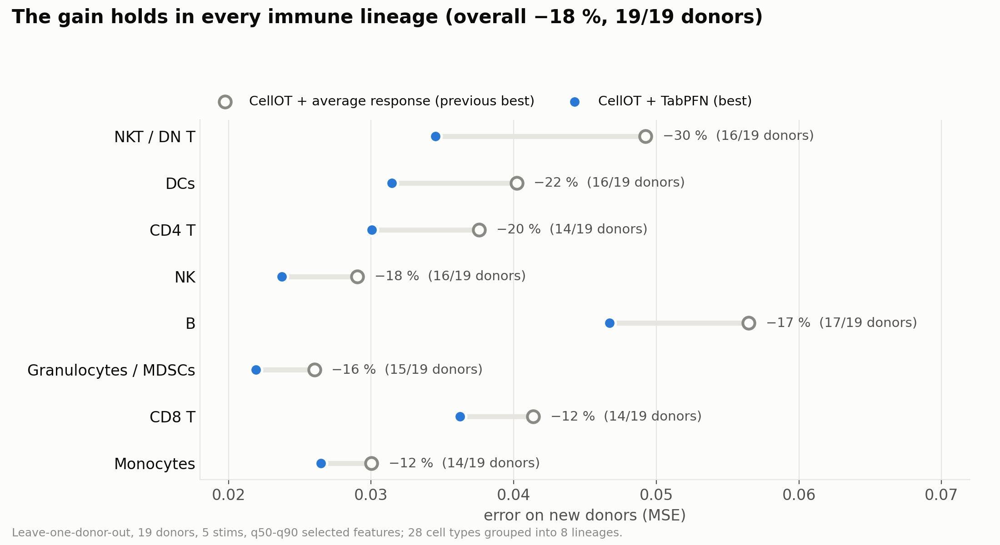
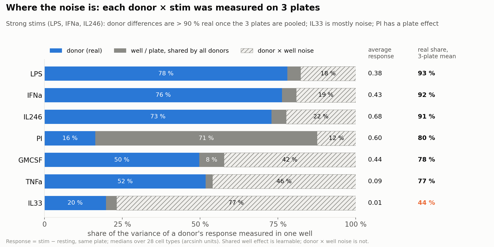
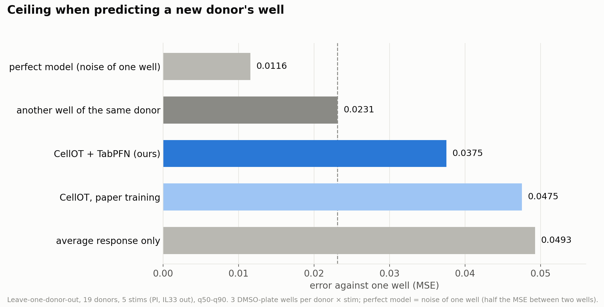
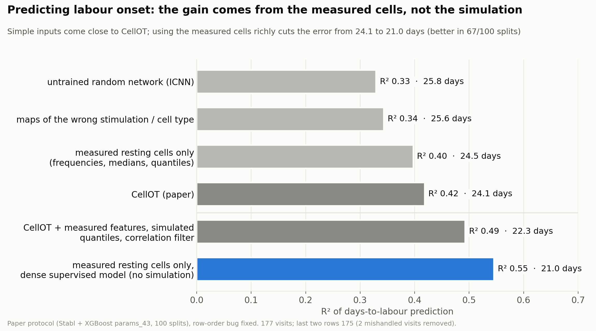
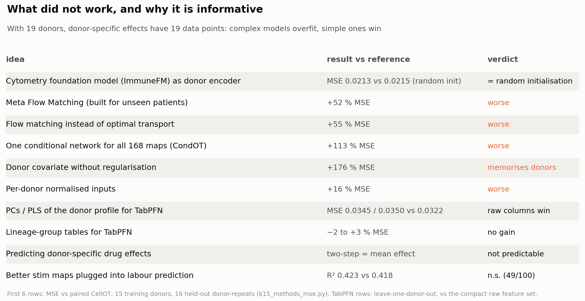

# Predicting immune responses of unseen patients: CellOT, baselines and donor covariates

Merwan Olivier Bennani, Gaudillière lab (Stanford), September–November 2026.

This repository collects **my own code** for a project built on SIMCO, the lab's single-cell digital twin for preterm
birth ([preprint](https://doi.org/10.1101/2025.09.29.679252), published code:
[github.com/ofondeur/SIMCO](https://github.com/ofondeur/SIMCO)). The published pipeline is not copied here.
No data is included (see *Data and reproducibility*).

## Context
SIMCO takes a pregnant woman's resting blood cells (mass cytometry, ~40 proteins per cell, 28 cell types), simulates how
they would respond to immune stimulations and drugs with **CellOT** (neural optimal transport: one map per stimulation ×
cell type, trained on an in-vitro atlas of 19 donors), and predicts the days until labour with Stabl + XGBoost.

The published maps had only been evaluated on held-out *cells* of the training donors. The real use is a **new patient**.
My main work asks: how well do these maps predict a donor they have never seen, how does that scale with the number of
donors, how much does the neural network add over simple baselines, and can donor covariates and tabular models do better?

**Headline:** on leave-one-donor-out (19 donors), the final model has **23 % lower error than the paper's CellOT**, is
better than the previous best for 18 of 19 donors, and improves every immune lineage.

---

## Core work: guided tour (all in [`1_heldout_stim_maps/`](1_heldout_stim_maps/README.md))

### 1. Held-out-donor evaluation and learning curve
Repeated designs with 4 held-out donors and k = 1…15 training donors, plus leave-one-donor-out; checkpoints and
hyper-parameters chosen on training donors only; paired per-donor comparisons.
- `lc/design.py`, `lc/score.py`, `lc/lodo_summary.py`; notebook [`notebooks/learning_curve.ipynb`](1_heldout_stim_maps/notebooks/learning_curve.ipynb) (with results, skill scale)
- Donor experiments (pregnant vs non-pregnant, cells vs donors): `lc/design_donors.py`, `lc/analyze_donors.py`, `lc/small_budget.py`

Finding: the error keeps falling up to 15 donors (RMSE 0.208 with 2 donors, 0.176 with 5, 0.152 with 15), and more
cells per donor barely help: the limit is the number of donors.

### 2. Baselines: how much does the neural network add?
Closed-form maps on exactly the same design: identity, median shift, per-marker quantile map, Gaussian OT (affine), and
the average response. `lc/baselines.py` (correctness tests on known maps in `3_paper_audit_and_dos/baselines/test_baselines.py`).

Finding: on new donors, CellOT is only 5 % better than adding the average response (9/19 donors), and the average
response is as accurate as CellOT at every training-set size (RMSE 0.151 vs 0.152 with 15 donors).

### 3. CellOT at scale (batched GPU training)
Up to 1,680 independent CellOT maps (input-convex networks, dual OT loss) trained as one GPU model with stacked weights;
~15 GPU-seconds per map instead of ~55 CPU-minutes.
- `lc/batched_icnn.py` (model), `lc/train.py` (trainer: per-map sampling, per-map checkpoint selection, resumable,
  atomic writes), `lc/cache.py` (one-pass h5py cache of each donor's cells, 23 GB → 789 MB)
- `lc/test_equivalence.py`: batched training == M reference trainings, exact in float64; plus a parity check against the
  paper's trained maps before any run
- `slurm/`: job arrays chained by dependencies

### 4. Donor covariates: patient-aware maps
- Conditional CellOT, convex in the cells for every covariate value (CondOT-style): `lc/cond_icnn.py`, `lc/cond_train.py`
  with covariates = the donor's resting profile (PCs), whole-blood profile, learned embeddings (incl. a foundation
  model, no gain) and phenotype subclusters (kept in the final model);
  regularised covariate path; variants of the conditioning architecture (`lc/var_score.py`)
- Closed-form conditional maps and residual models: `lc/cond_baselines.py`, `lc/residual_predict.py`
- Donor-ID oracle (how much of the response is learnable at all): `lc/cond_train.py`
- Paired sampling (one donor per batch) and ensembles with the average response: `lc/err_corr.py`, `lc/hybrid_rules.py`

Finding: a covariate overfits with few donors and helps from 5 (phenotype subclusters) or 15 (whole blood) donors.

### 5. Tabular models of the donor-specific response (TabPFN)
Predict a donor's deviation from the average response with TabPFN v2 / LightGBM, one table per (stim, cell type), then
mix with CellOT.
- `lc/tab_features.py`, `lc/tab_v2.py` (feature sets built step by step, lineage features, ablations, column reduction),
  `lc/tab_ens.py`, `lc/tab_compare.py`, `lc/tab_v2_shap.py`; notebook [`notebooks/tab_models.ipynb`](1_heldout_stim_maps/notebooks/tab_models.ipynb) (with results)
- Final comparison of ~60 methods: `lc/final_compare.py`, [`notebooks/final_comparison.ipynb`](1_heldout_stim_maps/notebooks/final_comparison.ipynb) (with results)

Finding: raw features beat PCs / PLS; adding the same marker measured in the donor's other 27 cell types helps; the gain
holds in every lineage.

### 6. Is the remaining error noise? ([`2_noise_ceiling/`](2_noise_ceiling/README.md))
Each donor × stimulation was measured on 3 plates, with all donors barcoded in every well, so the response splits into
donor, shared-well and donor × well noise.
- `2_noise_ceiling/wc/` (per-well quantiles of exactly the training cells, replicate-well ceilings, same-target
  comparison), `1_heldout_stim_maps/lc/plate_variance.py`, `lc/noise_floor_lodo.py`, `notebooks/dmso_plate.ipynb`

Finding: against a single measurement, our prediction for an unseen donor is 1.6× the gap between two repeat
measurements of the same donor, and as close as a repeat for GMCSF.

### 7. Drugs on new donors
`lc/drug_tab.py`, `lc/drug_step.py`, `heldout/score_drugs.py`; notebook `notebooks/drug_heldout.ipynb`. Donor-specific
drug effects are not predictable from resting cells; per-marker quantile maps beat CellOT drug maps on new donors.

---

## Context work: paper audit and labour-onset prediction ([`3_paper_audit_and_dos/`](3_paper_audit_and_dos/README.md))
- Reproduced the paper's Fig 5b exactly (R² 0.415, 24.1 days) and fixed a **row-order bug** in the scoring script
  (`stabl_launch/aligned_rescore.py`): 94 % of test samples had the same woman in training.
- Null maps: an untrained random network already reaches R² 0.33, measured resting cells 0.40, CellOT 0.42.
- Dense supervised learning on the measured cells (`ml_dos/`): **R² 0.545, 21.0 days**. The gain comes from the
  measured distribution, not from the simulation.

## Explorations (negative results, kept for completeness)
- [`explorations/meta_flow_matching/`](explorations/meta_flow_matching/README.md): Meta Flow Matching (ICLR 2025)
  re-implemented in plain PyTorch for unseen donors; clearly worse than CellOT.
- [`explorations/longitudinal_ool/`](explorations/longitudinal_ool/README.md): one delivery-date prediction per woman
  from her 3 visits, with leak-free landmarking; no signal beyond the average.
- Also in `1_heldout_stim_maps/fm/`: a cytometry foundation model (ImmuneFM) as donor encoder; no better than random init.

Every summary figure, with its message and the numbers plotted, is listed in [`figures/README.md`](figures/README.md).

## Tools
Python, PyTorch 2.4 (CUDA), NumPy / pandas / SciPy, h5py, scikit-learn, TabPFN v2, LightGBM, XGBoost, Stabl, Jupyter,
matplotlib; Slurm on Stanford's Sherlock cluster (~1,600 jobs, ~700 GPU-hours). Notebooks are generated by scripts
(`build_*.py`), so every number in their text is computed.

## Data and reproducibility
- The mass cytometry atlas and the pregnancy cohort are the lab's data and are **not included**; scripts read them from
  the lab's storage on Sherlock, so the code cannot be run outside it and paths are absolute. Results are visible in
  `figures/` (with the plotted numbers in `figures/data/`), in each folder's README, and in three notebooks kept with
  their outputs (aggregate and anonymous per-donor results only): `final_comparison`, `tab_models`, `learning_curve`.
  All other notebook outputs are stripped.
- Third-party weights are not included: ImmuneFM (no licence) and TabPFN v2 (download from Prior Labs).
